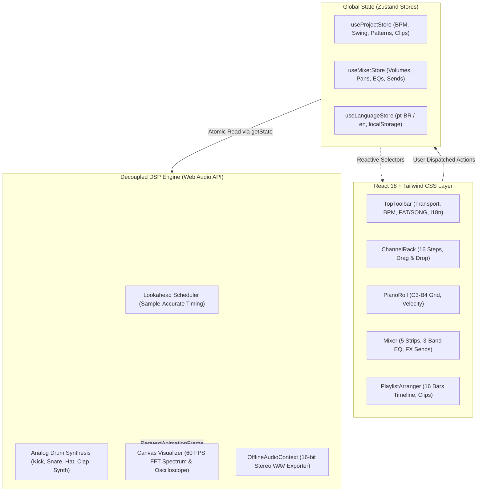

# 🎛️ MusicX Studio — Web FL Studio DAW (v2.0 Pro)

[🇧🇷 Português](README.md) | [🇺🇸 English](README.en.md)

> Digital Audio Workstation (DAW) in the browser inspired by the classic **FL Studio** workflow, built with **React 18**, **Tailwind CSS**, **TypeScript**, **Zustand**, and a low-latency, sample-accurate **Web Audio API** engine.

---

## 🌟 Overview

**MusicX Studio v2.0** recreates the beloved FL Studio music production ecosystem directly in the browser. All audio processing (analog drum synthesis, mixer routing, FX sends, and offline rendering) runs inside a **decoupled Audio Engine isolated from the React render cycle**, synchronized atomically via **Zustand** state stores.

---

## 🌊 Architecture & Modernized Core



---

## ✨ Features

### 1. 🎛️ Channel Rack & Step Sequencer
- **16-Step Grid**: Classic 4/4 rhythm grouping with alternating beat block colors (`fl-step-off-a` and `fl-step-off-b`).
- **Tactile Rotary Knobs (`<RotaryKnob />`)**: Smooth vertical dragging with pointer capture, fine sensitivity, bipolar support (Pan), and double-click to reset.
- **Instrument Selector & General MIDI SoundFonts**: Instantly switch any channel between analog drum synthesizers and real sampled/acoustic instruments:
  - 🎹 **Acoustic Grand Piano**
  - 🎹 **Rhodes Electric Piano**
  - 🎸 **Electric Bass (Finger)**
  - 🎻 **String Ensemble / Violins**
  - 🎸 **Nylon Acoustic Guitar**
  - 🎺 **80s Synth Brass**
  - 🪈 **Orchestral Flute**
- **Custom SoundFont 2 (`.sf2`) Support**: Drag and drop any `.sf2` instrument file onto any channel row for instantaneous PCM sample decoding and pitch-tracked playback.
- **Audio Sample Drag & Drop**: Drag `.wav` or `.mp3` audio files directly from your desktop onto any channel row to decode and play them instantly.
- **Swing / Groove Control**: Global shuffle timing slider (0% to 100%) dynamically adjusting odd 16th-note timings.

### 2. 🎚️ Dedicated Mixer & DSP Effects Rack
- **5 Audio Channels**: Dedicated **Master (MST)** strip with safety Master Limiter (-0.5 dB) + 4 independent insert tracks (`Kick`, `Snare`, `HiHat`, `Clap`).
- **3-Band Equalizer**: Individual `HI` (highshelf 4500 Hz), `MID` (peaking 1200 Hz), and `LOW` (lowshelf 250 Hz) filters (-12 dB to +12 dB) per track.
- **Auxiliary FX Sends**: Dedicated send knobs for **Reverb** (convolver impulse), **Stereo Delay** (feedback delay), and **Fast Distortion** (analog wave shaper with sigmoid curve).
- **Decibel-Calibrated Vertical Faders**: High-precision faders with numerical dB readouts (`0.0 dB`, `-6.0 dB`, `-inf`) and animated stereo VU peak meters.
- **60 FPS Real-Time Canvas Visualizer**: Toggle instantly between **Spectrum Analyzer (48-band FFT)** and **Oscilloscope (Stereo Waveform)**.

### 3. 🎹 Melodic Piano Roll & Velocity Graph
- **2-Octave Chromatic Grid (C3 to B4, 24 Semitones)**: Click to place or delete melodic notes with dedicated polyphonic synthesis.
- **Interactive Vertical Keyboard**: Clickable black and white keys with audio preview and root key indicators (*Root C*).
- **Note Duration Selector**: Support for 1/16, 1/8, or 1/4 bar note lengths.
- **Per-Step Velocity Graph Editor**: Bottom drawer with 16 vertical dynamic bars to tweak velocity per step (5% to 100%).

### 4. 🎵 Playlist Arranger & Offline WAV Export
- **16-Bar Multi-Track Timeline**: 4 horizontal tracks to arrange and sequence pattern clips.
- **Multi-Pattern Manager**: Switch between patterns or create new ones (`Pattern 1`, `Pattern 2`, etc.) via `< >` selectors and `+`.
- **Dual Playback Modes (`[PAT]` / `[SONG]`)**: Loop the active pattern or play the entire song arrangement with a timeline playhead ruler.
- **Demo Song Preset**: 1-click button to load a full demonstration track with Intro, Drop, and Outro sections.
- **Master WAV Export**: High-speed offline rendering via `OfflineAudioContext` for 16-bit stereo PCM WAV (44.1 kHz) instant downloads.

### 5. 🌐 Multilingual Support (i18n)
- **Brazilian Portuguese (`pt-BR`) by default**: Full Portuguese musical terminology.
- **English (`en`) selectable**: Instant toggle button **`[🌐 PT | EN]`** on the top toolbar translating the entire interface in real-time.
- **Automatic Persistence**: Language preference saved to `localStorage` (`musicx_lang`).

---

## 🔬 DSP Synthesis Architecture

All native sounds are generated mathematically in real time:

| Instrument | Channel | Synthesis Method | Technical Details |
| :--- | :--- | :--- | :--- |
| **Kick 808** | In 1 | Sine Wave + Exponential Pitch Modulation | Frequency drop from 150 Hz $\to$ 32 Hz in 120ms with 350ms exponential decay. |
| **Snare Hard** | In 2 | Triangle Wave + Filtered White Noise | Triangle body (180 Hz $\to$ 45 Hz) layered with high-pass filtered noise burst (1000 Hz). |
| **HiHat Clsd** | In 3 | 6 Square Oscillators + Bandpass/Highpass Filters | Classic 808 metallic ratios routed through band-pass (10 kHz) and high-pass (7.5 kHz). |
| **Clap 909** | In 4 | White Noise Micro-Bursts + Bandpass Filter | 3 consecutive bursts spaced by ~11ms followed by a decay tail centered at 1200 Hz ($Q=2$). |
| **Melodic Synth**| Dynamic | Sawtooth Wave + Polyphonic ADSR Envelope | Subtractive synthesis tuned via standard MIDI pitch formula ($f = 440 \times 2^{(midi-69)/12}$). |
| **SoundFonts GM** | Any | High-Definition Sampled SoundFont Banks (MusyngKite) | Multi-sampled acoustic stereo audio with velocity dynamics and authentic decay. |
| **SoundFont 2 (.sf2)** | Any | RIFF/SFBK 16-bit PCM Sample Decoder | Zero-dependency chunk parser with dynamic playback rate pitch-shifting. |
| **Custom Audio** | Any | Native `AudioBufferSourceNode` | Decoded on the fly via `AudioContext.decodeAudioData()`. |

---

## ⌨️ Global Keyboard Shortcuts

| Key | Action |
| :--- | :--- |
| <kbd>Space</kbd> | Toggle Play / Pause |
| <kbd>Enter</kbd> | Stop playback and reset playhead to start |
| <kbd>L</kbd> | Toggle between `PAT` (Pattern) and `SONG` (Playlist) modes |
| <kbd>1</kbd> | Open **Channel Rack** |
| <kbd>2</kbd> | Open **Piano Roll** |
| <kbd>3</kbd> | Open **Mixer** |
| <kbd>4</kbd> | Open **Playlist Arranger** |

---

## 📁 Project Structure

```
musicx-studio/
├── .devcontainer/
│   └── devcontainer.json      # GitHub Codespaces config (Public port 3000 forwarding)
├── src/
│   ├── audio/
│   │   ├── AudioEngine.ts     # Decoupled Web Audio singleton, DSP synths & scheduler
│   │   └── WavExporter.ts     # Offline 16-bit PCM stereo WAV exporter
│   ├── components/
│   │   ├── common/            # RotaryKnob dial, LcdDisplay
│   │   ├── mixer/             # Mixer rack, MixerStrip, AudioVisualizer Canvas
│   │   ├── pianoroll/         # PianoRoll chromatic matrix, VelocityGraph
│   │   ├── playlist/          # PlaylistArranger multi-track timeline
│   │   ├── rack/              # ChannelRack, ChannelRow (Drag & Drop sample zone)
│   │   └── toolbar/           # TopToolbar (Transport, LCD BPM, Language Switcher)
│   ├── i18n/
│   │   └── translations.ts    # Complete pt-BR and en dictionaries
│   ├── store/
│   │   ├── useLanguageStore.ts# Zustand store with localStorage persistence
│   │   ├── useMixerStore.ts   # Zustand store for strips, faders, EQs and FX sends
│   │   └── useProjectStore.ts # Zustand store for BPM, swing, channels, patterns, clips
│   ├── types/
│   │   └── index.ts           # TypeScript interfaces and domain models
│   ├── App.tsx                # Main application layout and window manager
│   ├── index.css              # Tailwind CSS directives & FL Studio dark scrollbars
│   ├── main.tsx               # React 18 DOM mount entry point
│   └── vite-env.d.ts          # Vite environment types
├── legacy/                    # Intact backup of original vanilla HTML/CSS/JS version
├── vite.config.ts             # Vite 6 configuration (host: true, allowedHosts: true)
├── tailwind.config.js         # FL Studio dark theme palette and grid definitions
├── tsconfig.json              # TypeScript compiler configuration
├── start.bat                  # 1-Click launcher for Windows
├── package.json               # Dependencies and build scripts
├── README.md                  # Portuguese documentation
└── README.en.md               # English documentation
```

---

## 🚀 Running Locally

### Option 1: Automatic 1-Click Launcher (Windows)
Double-click [`start.bat`](start.bat) in the project root folder. It will start Vite and automatically launch your default browser at `http://localhost:3000`.

### Option 2: Using NPM / Terminal
Ensure you have Node.js (v18+) installed and run:
```bash
npm run dev
```

### To Generate an Optimized Production Build:
```bash
npm run build
```

### To Run the Legacy Vanilla Version:
```bash
npm run legacy
```

---

## ☁️ Running on GitHub Codespaces

This repository includes a configured `.devcontainer/devcontainer.json`:
1. On GitHub, click **Code** > **Codespaces** > **Create codespace on main**.
2. In the Codespace terminal, run:
   ```bash
   npm run dev
   ```
3. Open port **3000** (`https://<codespace-name>-3000.app.github.dev/`).
4. *Tip*: If opening from an external tab results in a 401 error, click the **PORTS** tab in VS Code, right-click on port 3000, and change **Port Visibility** to **Public**.

---

## 🛠️ Tech Stack

- **React 18**: Declarative, component-based user interface.
- **Tailwind CSS 3.4**: Hardware-inspired FL Studio dark theme.
- **TypeScript 5.7**: Strict type safety across audio nodes, patterns, and channels.
- **Zustand 5**: Ultra-performant atomic state management preventing unnecessary React re-renders.
- **Web Audio API**: Native digital signal processing (DSP), synthesis, biquad filters, convolvers, and FFT analyzers.
- **Vite 6**: Next-generation frontend tooling and instant HMR with Docker/Codespaces support.
- **Lucide React**: Clean vector iconography for audio controls.

---

## 📄 License
Distributed under the [MIT](https://opensource.org/licenses/MIT) License.
