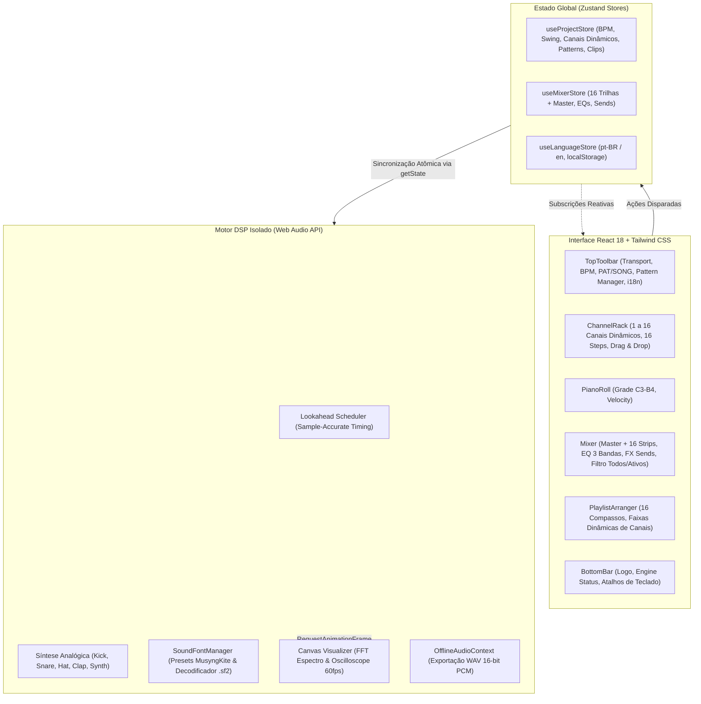

# 🎛️ MusicX Studio — Web FL Studio DAW (v2.0 Pro)

[🇧🇷 Português](README.md) | [🇺🇸 English](README.en.md)

> Estação de trabalho de áudio digital (DAW) inspirada no fluxo de trabalho do **FL Studio**, construída com **React 18**, **Tailwind CSS**, **TypeScript**, **Zustand** e o motor de alta precisão da **Web Audio API**.

---

## 🌟 Visão Geral

O **MusicX Studio v2.0** recria no navegador o ecossistema de produção musical do FL Studio. Todo o processamento de áudio (síntese analógica, roteamento no Mixer, instrumentos SoundFont acústicos, efeitos e exportação) roda em um **Audio Engine desacoplado e imune a travamentos da interface gráfica**, com sincronização atômica através de stores **Zustand**.

---

## 🌊 Arquitetura Modernizada



---

## ✨ Funcionalidades do DAW

### 1. 🎛️ Channel Rack & Canais Dinâmicos (1 a 16 Canais)
- **Canais DSP Dinâmicos (1 a 16 Canais)**: adicione novos canais sob demanda com o botão `+ Adicionar Canal`, com contador visual no cabeçalho (`X/16`) e bloqueio suave ao atingir o limite de 16 canais.
- **Exclusão Rápida & Renomeação Inline**:
  - Botão de lixeira individual por canal para remoção imediata (com trava de segurança preservando no mínimo 1 canal ativo).
  - Ícone de lápis para renomeação inline do canal, sincronizando instantaneamente o nome na respectiva trilha de inserção do Mixer.
- **Sequenciador de 16 Passos**: agrupamento rítmico clássico de 4 em 4 tempos em cores contrastantes (`fl-step-off-a` e `fl-step-off-b`).
- **Knobs Rotatórios Táteis (`<RotaryKnob />`)**: controle de volume e panorâmica com captura de ponteiro e arraste vertical suave. Suporte a modo bipolar (Pan) e duplo clique para resetar ao valor padrão.
- **Seletor de Instrumentos & SoundFonts Nativos**: alterne instantaneamente qualquer canal entre bateria analógica e instrumentos acústicos/amostrados reais:
  - 🎹 **Acoustic Grand Piano** (Piano de cauda acústico)
  - 🎹 **Rhodes Electric Piano** (Piano elétrico clássico)
  - 🎸 **Electric Bass (Finger)** (Baixo elétrico dedilhado)
  - 🎻 **String Ensemble / Violins** (Seção de cordas e violinos orquestrais)
  - 🎸 **Nylon Acoustic Guitar** (Violão de nylon)
  - 🎺 **80s Synth Brass** (Metais sintetizados retrô)
  - 🪈 **Orchestral Flute** (Flauta orquestral)
- **Suporte a Arquivos SoundFont 2 (`.sf2`) Customizados**: arraste e solte qualquer arquivo de instrumento `.sf2` diretamente no canal para decodificação instantânea de amostras PCM e reprodução realista.
- **Drag & Drop de Samples de Áudio**: arraste qualquer arquivo `.wav` ou `.mp3` do seu computador diretamente para a linha de qualquer canal para decodificá-lo e tocá-lo na hora.
- **Controle de Swing Groove**: ajuste de shuffle de 0% a 100% que atrasa os passos pares de semicolcheia com compensação temporal contínua.

### 2. 🎚️ Mixer Dedicado com Processador DSP (16 Trilhas + Master)
- **Mesa de Mixagem com 16 Inserts Independentes**:
  - Trilha **Master (MST)** com limitador de segurança Master Limiter (-0.5 dB).
  - **16 Trilhas de Inserção Independentes** pré-conectadas no grafo do Web Audio API com latência zero e custo de memória desprezível (~150 KB).
- **Filtro de Visualização `[Todos (16) | Ativos (X)]`**: alterne instantaneamente entre a visualização de todas as 16 trilhas da mesa ou filtre apenas os canais em uso no projeto.
- **Equalizador de 3 Bandas**: controles dedicados de `HI` (highshelf 4500 Hz), `MID` (peaking 1200 Hz) e `LOW` (lowshelf 250 Hz) variando de -12 dB a +12 dB por canal.
- **Envios de Efeitos (Sends FX)**: barramentos para **Reverb** (convolver de ambiência natural), **Stereo Delay** (eco estéreo com feedback) e **Distorção** (saturação analógica com curva sigmoide).
- **Faders Verticais Calibrados em Decibéis**: sliders com leitura numérica precisa (`0.0 dB`, `-6.0 dB`, `-inf`) e medidores VU estéreo dinâmicos.
- **Analisador de Espectro Canvas 60 FPS**: alternância instantânea entre **Espectro (FFT de 48 bandas)** e **Onda (Osciloscópio estéreo)**.

### 3. 🎹 Piano Roll Melódico & Graph Editor
- **Grade Cromática de 2 Oitavas (C3 a B4, 24 semitons)**: clique para adicionar ou remover notas melódicas com sintetizador polifônico dedicado ou instrumentos SoundFont.
- **Teclado Virtual Interativo**: teclas brancas e pretas com pré-escuta de afinação e indicação luminosa das notas fundamentais (*Root C*).
- **Seletor de Duração**: notas com comprimento de 1/16, 1/8 ou 1/4 de compasso.
- **Velocity Graph Editor**: gaveta inferior com 16 colunas verticais interativas para ajuste da intensidade e dinâmica (5% a 100%) por passo.

### 4. 🎵 Playlist Arranger & Exportação WAV
- **Timeline de 16 Compassos**: pistas horizontais adaptativas que sincronizam diretamente com os canais ativos (1 a 16 pistas), exibindo nome, cor e identificador da trilha (`Trk X`).
- **Seletor e Renomeação de Patterns**: alterne entre patterns criados, adicione novos com o botão `+`, ou renomeie qualquer padrão digitando diretamente na barra superior ou na Playlist (com salvamento via Enter e sincronização imediata em toda a timeline).
- **Modo Duplo `[PAT]` / `[SONG]`**: reproduza o padrão em loop ou execute o arranjo completo da Playlist com régua animada.
- **Preset Demo Song**: botão para carregar uma música completa de demonstração com Intro, Drop e Outro.
- **Exportação Master WAV**: renderização offline rápida via `OfflineAudioContext` para download de arquivo `.wav` estéreo de 16-bit PCM (44.1 kHz), compatível com todos os canais analógicos e SoundFonts dinâmicos.

### 5. 🌐 Suporte Multilíngue (i18n)
- **Português (`pt-BR`) por padrão**: terminologia e interface totalmente em português brasileiro.
- **Inglês (`en`) selecionável**: botão de alternância **`[🌐 PT | EN]`** na barra superior com tradução instantânea em toda a interface.
- **Persistência Automática**: salva a preferência do idioma no `localStorage` (`musicx_lang`).

---

## 🔬 Arquitetura de Síntese DSP

Todo o áudio nativo é gerado matematicamente em tempo real:

| Instrumento | Canal | Método de Síntese | Detalhes Técnicos |
| :--- | :--- | :--- | :--- |
| **Kick 808** | In 1 (ou dinâmico) | Onda Senoidal + Modulação Exponencial de Pitch | Queda de frequência de 150 Hz $\to$ 32 Hz em 120ms com decaimento exponencial de 350ms. |
| **Snare Hard** | In 2 (ou dinâmico) | Triângulo + Ruído Branco Filtrado | Corpo em triângulo (180 Hz $\to$ 45 Hz) somado a disparo de ruído filtrado em passa-alta (1000 Hz). |
| **HiHat Clsd** | In 3 (ou dinâmico) | 6 Osciladores Quadrados + Filtros Passa-Banda e Alta | Razões harmônicas clássicas (808) processadas por passa-banda (10 kHz) e passa-alta (7.5 kHz). |
| **Clap 909** | In 4 (ou dinâmico) | Ruído Branco em Micro-Bursts + Passa-Banda | 3 rajadas consecutivas espaçadas em ~11ms seguidas de cauda reverberada cortada em 1200 Hz ($Q=2$). |
| **Synth Melódico**| Dinâmico | Oscilador Dente de Serra (Sawtooth) + ADSR | Síntese subtrativa polifônica afinada por fórmula MIDI ($f = 440 \times 2^{(midi-69)/12}$). |
| **SoundFonts GM** | Dinâmico (1-16) | Bancos Amostrados de Alta Definição (MusyngKite) | Multi-samples acústicos estéreo com resposta tátil de dinâmica e sustentação harmônica. |
| **SoundFont 2 (.sf2)** | Dinâmico (1-16) | Decodificador RIFF/SFBK PCM 16-bit | Parser de chunks com re-amostragem dinâmica de playback rate por semitons. |
| **Custom Audio** | Dinâmico (1-16) | `AudioBufferSourceNode` nativo | Decodificação em memória via `AudioContext.decodeAudioData()`. |

---

## ⌨️ Atalhos de Teclado Globais

| Tecla | Ação |
| :--- | :--- |
| <kbd>Barra de Espaço</kbd> | Alternar Play / Pause |
| <kbd>Enter</kbd> | Parar reprodução (Stop) e reiniciar cursor |
| <kbd>L</kbd> | Alternar entre modo `PAT` (Pattern) e `SONG` (Playlist) |
| <kbd>1</kbd> | Abrir **Channel Rack** |
| <kbd>2</kbd> | Abrir **Piano Roll** |
| <kbd>3</kbd> | Abrir **Mixer** |
| <kbd>4</kbd> | Abrir **Playlist Arranger** |

---

## 📁 Estrutura do Projeto

```
musicx-studio/
├── .devcontainer/
│   └── devcontainer.json      # Configuração para GitHub Codespaces (Porta 3000 pública)
├── src/
│   ├── audio/
│   │   ├── AudioEngine.ts     # Singleton de áudio, síntese analógica, roteamento 16 tracks e scheduler
│   │   ├── SoundFontManager.ts# Gerenciador de SoundFonts acústicos e parser .sf2
│   │   └── WavExporter.ts     # Renderizador offline estéreo 16-bit PCM WAV (suporta 1-16 canais)
│   ├── components/
│   │   ├── common/            # RotaryKnob tátil, LcdDisplay
│   │   ├── mixer/             # Mixer rack (16 inserts + master), MixerStrip, AudioVisualizer Canvas
│   │   ├── pianoroll/         # PianoRoll, VelocityGraph
│   │   ├── playlist/          # PlaylistArranger Timeline dinâmica
│   │   ├── rack/              # ChannelRack (1 a 16 canais), ChannelRow (Drag & Drop, Rename, Delete)
│   │   └── toolbar/           # TopToolbar compacta e responsiva (Transporte, BPM, Seletor de Idiomas)
│   ├── i18n/
│   │   └── translations.ts    # Dicionários completos pt-BR e en
│   ├── store/
│   │   ├── useLanguageStore.ts# Zustand store com persistência localStorage
│   │   ├── useMixerStore.ts   # Zustand store para 16 pistas, faders e FX
│   │   └── useProjectStore.ts # Zustand store para canais dinâmicos (1-16), BPM, patterns e clips
│   ├── types/
│   │   └── index.ts           # Interfaces e definições TypeScript
│   ├── App.tsx                # Layout principal, gerenciador de janelas e status bar inferior
│   ├── index.css              # Diretivas Tailwind CSS e scrollbars FL Studio
│   ├── main.tsx               # Ponto de montagem React 18
│   └── vite-env.d.ts          # Tipos de ambiente Vite
├── legacy/                    # Backup intacto da versão original (HTML/CSS/JS puros)
├── vite.config.ts             # Configuração do Vite 6 (host: true, allowedHosts: true)
├── tailwind.config.js         # Configuração de temas e cores FL Studio
├── tsconfig.json              # Configurações do compilador TypeScript
├── start.bat                  # Inicializador rápido de 1 clique para Windows
├── package.json               # Dependências e scripts
├── README.md                  # Documentação em Português
└── README.en.md               # Documentação em Inglês
```

---

## 🚀 Como Executar Localmente

### Opção 1: Inicializador Automático (1 Clique no Windows)
Basta dar **duplo clique** no arquivo [`start.bat`](start.bat) na raiz do projeto! Ele iniciará o servidor Vite e abrirá seu navegador automaticamente em `http://localhost:3000`.

### Opção 2: Pelo Terminal com Node.js / NPM
Certifique-se de ter o Node.js instalado (v18+) e execute:
```bash
npm run dev
```

### Para Gerar o Pacote de Produção Minificado:
```bash
npm run build
```

### Para Rodar a Versão Legada (Vanilla JS):
```bash
npm run legacy
```

---

## ☁️ Como Executar no GitHub Codespaces

O repositório já conta com configuração prévia em `.devcontainer/devcontainer.json`:
1. No GitHub, clique em **Code** > **Codespaces** > **Create codespace on main**.
2. No terminal do Codespaces, execute:
   ```bash
   npm run dev
   ```
3. Acesse a **porta 3000** (`https://<codespace-name>-3000.app.github.dev/`).
4. *Dica*: caso acesse de uma nova aba e veja erro de autenticação, abra a aba **PORTS** no VS Code, clique com o botão direito na porta 3000 e defina **Port Visibility** como **Public**.

---

## 🛠️ Tecnologias Utilizadas

- **React 18**: Interface declarativa e componentes modulares.
- **Tailwind CSS 3.4**: Design system industrial escuro fiel ao FL Studio.
- **TypeScript 5.7**: Tipagem estática rigorosa para notas, tracks e nós de áudio.
- **Zustand 5**: Gerenciamento de estado de ultra-performance imune a re-renders desnecessários.
- **Web Audio API**: Processamento de sinal digital em tempo real (DSP), osciladores, filtros biquad, convolvers, nós de ganho e analisadores FFT.
- **SoundFonts & SF2**: Suporte híbrido a soundfont-player (presets MusyngKite) e decodificador soundfont2 para instrumentos acústicos e orquestrais.
- **Vite 6**: Ambiente de build e HMR ultrarrápido com suporte a Docker e Codespaces.
- **Lucide React**: Ícones de alta legibilidade para produção musical.

---

## 📄 Licença
Distribuído sob a licença [MIT](https://opensource.org/licenses/MIT).
