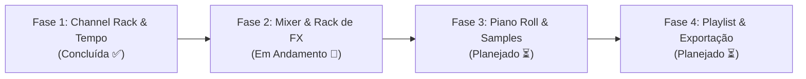

# 🎛️ MusicX Studio — Web FL Studio DAW

> Estação de trabalho de áudio digital (DAW) inspirada no clássico fluxo de trabalho do **FL Studio**, construída 100% com tecnologias web nativas (**HTML5, CSS3 e Web Audio API**) sem nenhuma dependência externa pesada ou bibliotecas de terceiros.

---

## 🌟 Visão Geral

O **MusicX Studio** recria no navegador o ecossistema de produção musical do FL Studio. Todos os instrumentos (Kick, Snare, Hi-Hat, Clap e Bass 303) são **sintetizados em tempo real** através de osciladores, filtros biquad e geradores de ruído da própria **Web Audio API**.

---

## ✨ Funcionalidades Atuais

- **🎹 Sequenciador de 16 Passos (4/4)**:
  - Divisão visual clássica de 4 em 4 passos (blocos alternados em carvão e laranja característicos).
  - Pré-escuta instantânea do som ao clicar e ativar qualquer *pad*.
  - Indicador visual luminoso e sincronizado com o passo atual em reprodução (*playhead*).

- **🔊 Síntese Sonora em Tempo Real (Zero Samples / Zero Downloads)**:
  - Nenhum arquivo `.wav` ou `.mp3` externo obrigatório. Todo o áudio é sintetizado matematicamente no processador do navegador.
  - Carregamento instantâneo e funcionamento 100% offline.

- **🎚️ Controles por Canal**:
  - **Mute LED**: Ative ou silencie qualquer canal individualmente com um clique no LED verde.
  - **Knob de Volume (V)**: Controle de ganho dedicado para cada instrumento (0 a 100%).
  - **Identificação Visual**: Estilo industrial com nomes dos canais em botões compactos.

- **⏱️ Motor de Tempo e Transporte de Alta Precisão**:
  - **BPM Ajustável & Digitável**: Controle bidirecional via slider e display digital LCD interativo (40 a 240 BPM).
  - **Displays LCD Retrô**: Leituras digitais verdes para o andamento (BPM) e para o passo atual (`STEP 01` a `16`).
  - **Algoritmo Lookahead Scheduler**: Implementação do padrão de temporização precisa de áudio web (*A Tale of Two Clocks*), garantindo que a reprodução não sofra engasgos (*jitter*) causados pela renderização da interface.

---

## 🎚️ Pilares de Inspiração do FL Studio

O projeto segue a filosofia dos pilares fundamentais do FL Studio:

1. **Channel Rack com Sequenciador de Passos**: Criação rápida de padrões rítmicos com controle de velocidade, panorâmica e swing.
2. **Mixer com Rack de Efeitos**: Roteamento independente de cada canal para pistas com faders, medidores de volume (VU meters) e cadeias de efeitos (Delay, Reverb, Distorção, EQ).
3. **Piano Roll Melódico**: Composição melódica com grid de notas, escalas musicais, acordes pré-configurados e suporte a glides.
4. **Playlist / Arranjador**: Linha do tempo multi-pista para posicionar e encadear diferentes *patterns* montando a música inteira.
5. **Browser Lateral de Samples**: Navegador em árvore com suporte a *drag-and-drop* de arquivos `.wav` do usuário.
6. **Exportação de Áudio**: Renderização ultrarrápida do arranjo para `.wav` através da `OfflineAudioContext`.

---

## 🔬 Arquitetura de Síntese Sonora

Cada canal possui seu próprio circuito virtual construído com nós de áudio nativos:

| Canal | Instrumento | Método de Síntese | Características Técnicas |
| :--- | :--- | :--- | :--- |
| **Kick 808** | Bumbo Sub | Oscilador Senoidal + Modulação de Pitch | Queda exponencial de frequência (150 Hz $\to$ 0.01 Hz) em 400ms com curva rápida de ganho. |
| **Snare Hard** | Caixa | Ruído Branco + Highpass Filter | Buffer de ruído aleatório cortado em 1000 Hz com decaimento acentuado de 180ms. |
| **Hat Closed** | Chimbal Fechado | Ruído Branco + Highpass Filter Extremo | Buffer de ruído filtrado em 7000 Hz com decaimento ultracurto de 50ms. |
| **Clap 90s** | Palma Vintage | Ruído Branco + Bandpass Filter | Filtro passa-faixa centrado em 1200 Hz ($Q=2$) com envelope de 220ms. |
| **303 Bass** | Baixo Ácido | Oscilador Dente de Serra (Sawtooth) + Lowpass Sweep | Inspirado no lendário Roland TB-303 (Nota C2 / 65.41 Hz) com varredura dinâmica de corte de filtro (600 Hz $\to$ 120 Hz). |

---

## 🗺️ Roadmap de Desenvolvimento



### ✅ Fase 1: Channel Rack e Motor de Áudio (Concluída)
- [x] Sequenciador de 16 passos com divisão em blocos FL Studio (4/4).
- [x] Síntese pura via Web Audio API para bateria e baixo 303.
- [x] Transporte (Play / Stop) com relógio de áudio sem latência.
- [x] Controle de BPM com display LCD interativo digitável e sincronizado ao slider.
- [x] Configuração para GitHub Codespaces (`.devcontainer`).

### ✅ Fase 2: Mixer e Rack de Efeitos (Concluída)
- [x] **Interface do Mixer**: Pistas de canais (Master + 5 canais dedicados) com faders verticais e panorâmica.
- [x] **Medidores de Pico (VU Meters Animados)**: Canvas com barra luminosa em tempo real via `AnalyserNode`.
- [x] **Rack de Efeitos (Master Insert FX)**:
  - **Fruity Delay 3**: Eco estéreo com feedback e tempo sincronizado ao andamento.
  - **Fruity Reeverb 2**: Convolução / algoritmo de ambiência e espaço.
  - **Fast Distortion**: Aquecimento e saturação de harmônicos via `WaveShaperNode`.
  - **Master DJ Filter**: Filtro passa-baixa e passa-alta dinâmico com varredura de Cutoff e Ressonância ($Q$).
- [x] **Roteamento de Canais**: Cada som do Channel Rack ligado à sua respectiva pista no Mixer.

### ✅ Fase 3: Piano Roll Melódico e Expressividade (Concluída)
- [x] **Piano Roll Interativo**: Grade melódica de 2 oitavas (C2 a C4, 24 semitons) para compor melodias e linhas de baixo.
- [x] **Teclado de Piano Vertical**: Teclas brancas e pretas clicáveis com pré-escuta instantânea de afinação.
- [x] **Sincronização Bidirecional**: Notas desenhadas no Piano Roll acionam os pads do Channel Rack com indicador visual `🎹`.
- [x] **Ferramentas de Composição**: Botões de transposição por oitava (`+ Octave` / `- Octave`), preset de riff Acid e limpeza rápida.
- [x] **Playhead Luminoso Sincronizado**: Linha vertical ciano que percorre os compassos em tempo real durante a reprodução.
- [x] **Controle de Swing / Groove Global**: Fader de shuffle (0% a 100%) no Channel Rack que atrasa os passos pares para conferir balanço rítmico (House, Trap, Garage).
- [x] **Graph Editor de Velocity por Passo**: Gaveta de ajuste vertical de volume para cada passo (10% a 100%) com suporte a desenho contínuo por arrasto do mouse e sombreamento nos pads.
- [x] **Drag-and-Drop de Samples de Áudio**: Arraste arquivos `.wav`/`.mp3` direto do computador para qualquer canal para usar seus próprios sons.

### ✅ Fase 4: Playlist / Arranjador e Exportação (Concluída)
- [x] **Múltiplos Patterns**: Crie e alterne entre `Pattern 1`, `Pattern 2`, `Pattern 3` com seletor `<` `>` e botão `+`.
- [x] **Modo PAT vs SONG**: Alternância clássica entre tocar apenas o loop do padrão ativo ou a timeline completa da música.
- [x] **Playlist Multi-Pistas (Arranger)**: Grade horizontal de 16 compassos em 4 pistas com posicionamento e remoção de blocos de padrões.
- [x] **Playhead da Playlist**: Indicador luminoso sincronizado que percorre os compassos durante a execução em modo SONG.
- [x] **Preset Demo Song**: Botão que monta um arranjo completo demonstrativo na timeline com Intro, Drop e Outro.
- [x] **Exportação WAV em Alta Definição**: Renderização ultrarrápida via `OfflineAudioContext` para download de arquivo `.wav` estéreo 16-bit 44.1kHz.

---

## 📁 Estrutura do Projeto

```
musicx-studio/
├── .devcontainer/
│   └── devcontainer.json   # Configuração para GitHub Codespaces (Live Server e portas)
├── index.html              # Interface e marcação da aplicação
├── style.css               # Folha de estilos modular (estética FL Studio)
├── app.js                  # Lógica do sequenciador, DSP e motor de áudio Web Audio API
├── server.js               # Servidor local nativo zero-dependência (Node.js)
├── start.bat               # Inicializador de 1 clique para Windows
├── package.json            # Scripts de inicialização
└── README.md               # Documentação do projeto
```

---

## 🚀 Como Executar Localmente no seu Computador

### Opção 1: Executar com Node.js (Recomendado)
No terminal do projeto, execute:
```powershell
node server.js
```
*(O navegador abrirá automaticamente em `http://localhost:3000`)*.

### Opção 2: Pelo arquivo `start.bat` (1 Clique no Windows)
Basta dar **dois cliques** no arquivo `start.bat` na pasta do projeto no Windows Explorer!

### Opção 3: Abrir direto no Navegador
Dê dois cliques no arquivo `index.html` para abrir diretamente no Chrome, Edge, Brave ou Firefox.

### 3. No GitHub Codespaces (Na Nuvem)
Este repositório já conta com **Dev Containers** configurados:
1. No topo do repositório no GitHub, clique no botão **Code** > aba **Codespaces**.
2. Clique em **Create codespace on main**.
3. O ambiente será montado com a extensão **Live Server** pré-instalada.
4. Clique em **"Go Live"** no rodapé do VS Code ou execute `npm run dev` no terminal integrado.

---

## 🛠️ Tecnologias Utilizadas

- **HTML5**: Estrutura semântica e acessível.
- **CSS3 Moderno**: Variáveis CSS (Custom Properties), Flexbox, gradientes, sombras internas simulando hardware analógico (*skeuomorphism*) e micro-animações.
- **JavaScript (ES6+)**: Lógica reativa do sequenciador e gerenciamento de estado.
- **Web Audio API**: `AudioContext`, `OscillatorNode`, `AudioBufferSourceNode`, `BiquadFilterNode`, `GainNode`, `DelayNode`, `ConvolverNode`, `WaveShaperNode`, `AnalyserNode` e `StereoPannerNode`.

---

## 📄 Licença

Este projeto é de código aberto sob a licença [MIT](https://opensource.org/licenses/MIT).
