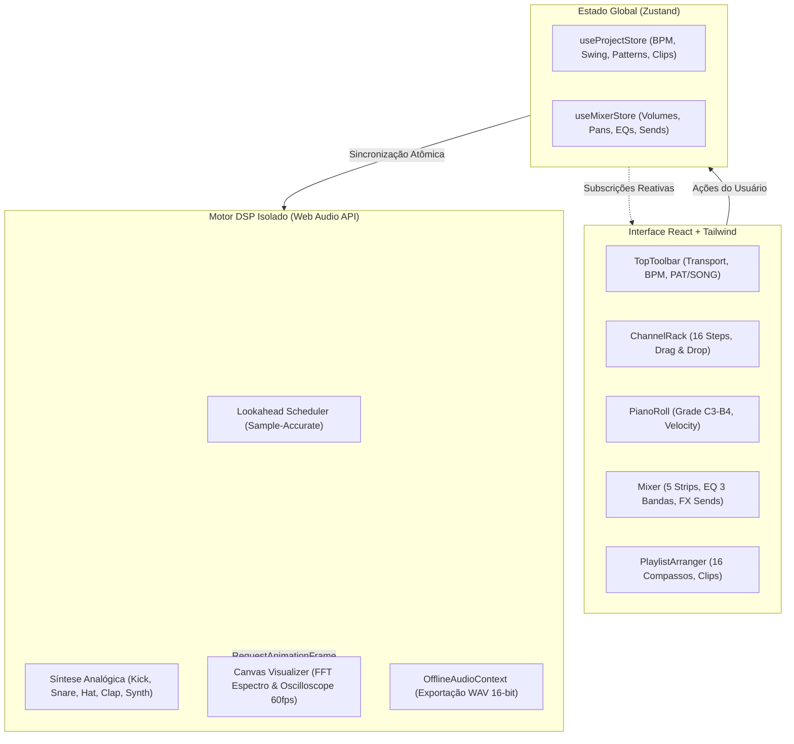

# 🎛️ MusicX Studio — Web FL Studio DAW (v2.0 Pro)

> Estação de trabalho de áudio digital (DAW) inspirada no fluxo de trabalho do **FL Studio**, construída com **React 18**, **Tailwind CSS**, **TypeScript**, **Zustand** e o motor de alta precisão da **Web Audio API**.

---

## 🌟 Visão Geral

O **MusicX Studio v2.0** recria no navegador o ecossistema de produção musical do FL Studio. Todo o processamento de áudio (síntese analógica, roteamento no Mixer, efeitos e exportação) roda em um **Audio Engine desacoplado e imune a travamentos da interface gráfica**, com sincronização atômica através de stores **Zustand**.

---

## 🌊 Arquitetura Modernizada (As 6 Ondas Concluídas)



---

## ✨ Funcionalidades do DAW

### 1. 🎛️ Channel Rack & Sequenciador de Passos
- **Sequenciador de 16 passos**: agrupamento rítmico clássico de 4 em 4 tempos em cores contrastantes.
- **Knobs Rotatórios Táteis (`<RotaryKnob />`)**: controle de volume e panorâmica com captura de ponteiro e arraste vertical suave. Duplo clique para resetar.
- **Drag & Drop de Samples**: arraste qualquer arquivo `.wav` ou `.mp3` do seu computador para qualquer canal para carregar e tocar na hora.
- **Controle de Swing Groove**: ajuste de shuffle de 0% a 100% compensado em tempo real no relógio de áudio.

### 2. 🎚️ Mixer Dedicado com Processador DSP
- **5 Pistas de Áudio**: Pista **Master (MST)** com Master Limiter (-0.5 dB) + 4 pistas de inserts independentes.
- **Equalizador de 3 Bandas**: controles dedicados de `HI`, `MID` e `LOW` (-12 dB a +12 dB) por canal.
- **Envios de Efeitos (Sends FX)**: barramentos para **Reverb**, **Stereo Delay** e **Distorção valvulada**.
- **Faders Verticais Calibrados em Decibéis**: sliders com leitura numérica precisa e medidores VU estéreo animados.
- **Analisador de Espectro Canvas 60 FPS**: alternância instantânea entre **Espectro (FFT de 48 bandas)** e **Onda (Osciloscópio estéreo)**.

### 3. 🎹 Piano Roll Melódico & Graph Editor
- **Grade Cromática de 2 Oitavas (C3 a B4, 24 semitons)**: clique para adicionar ou remover notas melódicas.
- **Teclado Virtual Interativo**: teclas brancas e pretas com pré-escuta de tom e indicação das notas fundamentais (*Root C*).
- **Seletor de Duração**: notas em 1/16, 1/8 ou 1/4 de compasso.
- **Velocity Graph Editor**: gaveta inferior com 16 colunas verticais para ajuste individual da intensidade e dinâmica de cada passo.

### 4. 🎵 Playlist Arranger & Exportação WAV
- **Timeline de 16 Compassos**: 4 pistas horizontais para organização e encadeamento de patterns.
- **Seletor de Patterns Múltiplos**: alterne entre `Pattern 1`, `Pattern 2`, etc. ou crie novos patterns com o botão `+`.
- **Modo Duplo `[PAT]` / `[SONG]`**: reproduza o padrão em loop ou execute o arranjo completo da Playlist com régua animada.
- **Preset Demo Song**: botão para carregar uma música completa de demonstração.
- **Exportação Master WAV**: renderização offline rápida para download de arquivo `.wav` estéreo de 16-bit PCM (44.1 kHz).

---

## ⌨️ Atalhos de Teclado Globais

| Tecla | Ação |
| :--- | :--- |
| <kbd>Barra de Espaço</kbd> | Alternar Play / Pause |
| <kbd>Enter</kbd> | Parar reprodução (Stop) e reiniciar cursor |
| <kbd>L</kbd> | Alternar entre modo `PAT` e `SONG` |
| <kbd>1</kbd> | Abrir **Channel Rack** |
| <kbd>2</kbd> | Abrir **Piano Roll** |
| <kbd>3</kbd> | Abrir **Mixer** |
| <kbd>4</kbd> | Abrir **Playlist Arranger** |

---

## 📁 Estrutura do Projeto

```
musicx-studio/
├── src/
│   ├── audio/
│   │   ├── AudioEngine.ts     # Singleton de áudio, DSP, síntese e scheduler
│   │   └── WavExporter.ts     # Renderizador offline estéreo 16-bit PCM WAV
│   ├── components/
│   │   ├── common/            # RotaryKnob tátil, LcdDisplay
│   │   ├── mixer/             # Mixer, MixerStrip, AudioVisualizer Canvas
│   │   ├── pianoroll/         # PianoRoll, VelocityGraph
│   │   ├── playlist/          # PlaylistArranger Timeline
│   │   ├── rack/              # ChannelRack, ChannelRow (Drag & Drop)
│   │   └── toolbar/           # TopToolbar (Transporte, BPM, Modos)
│   ├── store/
│   │   ├── useMixerStore.ts   # Zustand store para pistas, faders e FX
│   │   └── useProjectStore.ts # Zustand store para BPM, patterns e clips
│   ├── types/
│   │   └── index.ts           # Interfaces e definições TypeScript
│   ├── App.tsx                # Layout principal e gerenciador de janelas
│   ├── index.css              # Diretivas Tailwind CSS e scrollbars FL Studio
│   └── main.tsx               # Ponto de montagem React 18
├── legacy/                    # Backup intacto da versão original (HTML/CSS/JS puros)
├── vite.config.ts             # Configuração do Vite 6
├── tailwind.config.js         # Configuração de temas e cores FL Studio
├── tsconfig.json              # Configurações do compilador TypeScript
├── start.bat                  # Inicializador rápido de 1 clique para Windows
├── package.json               # Dependências e scripts
└── README.md                  # Documentação do projeto
```

---

## 🚀 Como Executar Localmente

### Opção 1: Inicializador Automático (1 Clique no Windows)
Basta dar **duplo clique** no arquivo [`start.bat`](start.bat) na raiz do projeto! Ele iniciará o servidor Vite e abrirá seu navegador automaticamente em `http://localhost:3000`.

### Opção 2: Pelo Terminal com Node.js / NPM
Certifique-se de ter o Node.js instalado (v18+) e execute:
```bash
npm run dev
```

### Para Gerar o Pacote de Produção Minificado:
```bash
npm run build
```

### Para Rodar a Versão Legada (Vanilla JS):
```bash
npm run legacy
```

---

## 🛠️ Tecnologias Utilizadas

- **React 18**: Interface declarativa e componentes modulares.
- **Tailwind CSS 3.4**: Design system industrial escuro fiel ao FL Studio.
- **TypeScript 5.7**: Tipagem estática rigorosa para notas, tracks e nós de áudio.
- **Zustand 5**: Gerenciamento de estado de ultra-performance imune a re-renders desnecessários.
- **Web Audio API**: Processamento de sinal digital em tempo real (DSP), osciladores, filtros biquad, convolvers e analisadores FFT.
- **Vite 6**: Ambiente de build e HMR ultrarrápido.
- **Lucide React**: Ícones de alta legibilidade para produção musical.

---

## 📄 Licença
Distribuído sob a licença [MIT](https://opensource.org/licenses/MIT).
