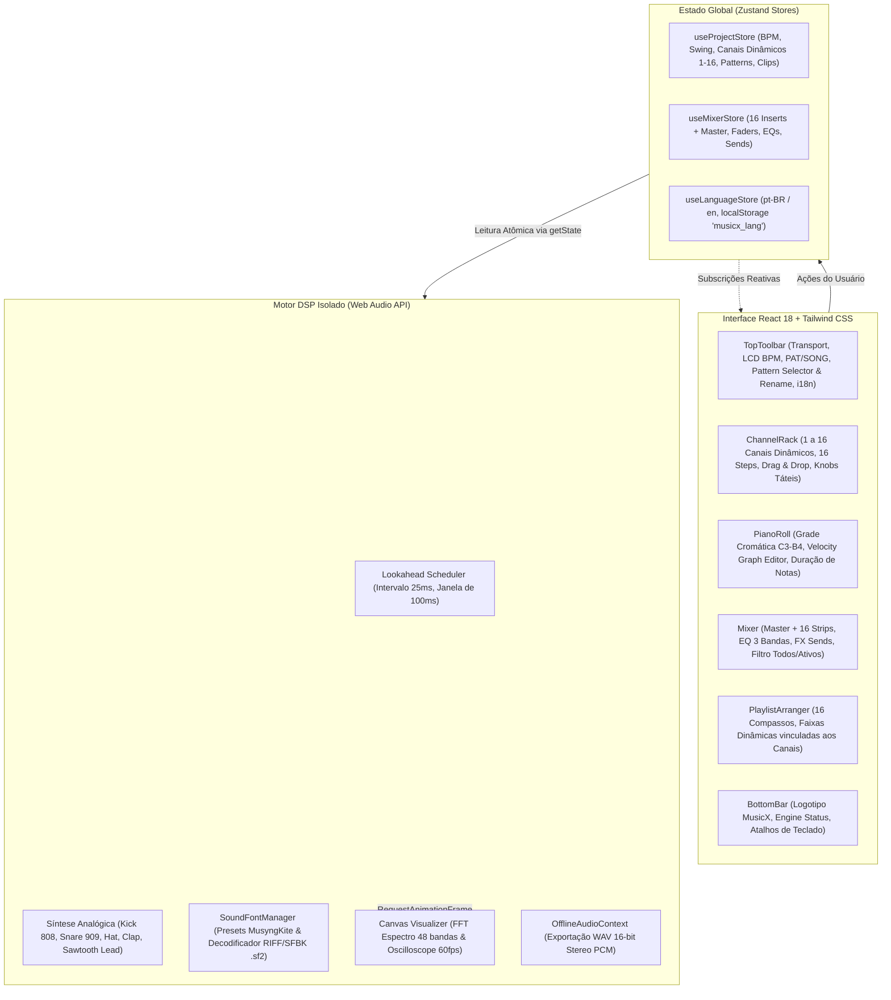

# 🧭 MusicX Studio v2.0 Pro — Contexto Geral do Projeto & Handoff

> **Data de Atualização**: 29 de Outubro de 2026  
> **Repositório**: `jhcarboni/musicx-studio`  
> **Branch Principal**: `main` (Sincronizada com `origin/main`)  
> **Branch de Feature**: `feat/dynamic-channels` (Sincronizada com `origin/feat/dynamic-channels`)

---

## 1. 📌 Resumo do Projeto

O **MusicX Studio** é uma Digital Audio Workstation (DAW) completa executada 100% no navegador (Client-side), inspirada no fluxo de trabalho e estética industrial do **FL Studio**.
Originalmente concebido como uma aplicação legada de arquivo único (`legacy/app.js` e `legacy/style.css`), o projeto foi integralmente refatorado e modernizado para uma arquitetura profissional baseada em:

* **React 18** + **Vite 6** + **TypeScript 5.7**
* **Tailwind CSS 3.4** com tema personalizado FL Studio escuro (`#1a1d24`, `#232731`, `#ff851b`, `#00ffcc`, etc.)
* **Zustand 5** com stores atômicas desacopladas
* **Web Audio API** de alta precisão (Lookahead Scheduler amostra-a-amostra)
* **SoundFonts Híbridos** (`soundfont-player` com bancos MusyngKite e decodificador PCM direto `soundfont2` para arquivos `.sf2`)

---

## 2. 🏛️ Arquitetura do Sistema



---

## 3. 📜 Linha do Tempo e Funcionalidades Implementadas

### Fase 1: Modernização das 6 Ondas Fundamentais
1. **Onda 0 (Fundação)**: Setup do Vite 6, TypeScript, Tailwind CSS com paleta FL Studio e tipagens estritas.
2. **Onda 1 (Audio Engine & Store)**: Lookahead scheduler desvinculado do ciclo React, stores Zustand (`useProjectStore`, `useMixerStore`, `useLanguageStore`).
3. **Onda 2 (Channel Rack & Sequencer)**: Sequenciador de 16 passos com blocos de 4 tempos alternados, knobs rotatórios táteis `<RotaryKnob />` verticais com reset em duplo clique, drag-and-drop de samples `.wav`/`.mp3`.
4. **Onda 3 (Mixer & DSP)**: Mesa com Master Limiter (-0.5 dB), equalizador de 3 bandas, sends de efeitos (Reverb, Delay, Distorção) e visualizador de espectro/osciloscópio a 60 FPS em Canvas.
5. **Onda 4 (Piano Roll & Velocity)**: Teclado virtual interativo C3 a B4 (24 semitons), suporte a notas polifônicas, seletor de duração (1/16, 1/8, 1/4) e gaveta inferior de edição de velocidade por passo.
6. **Onda 5 (Playlist & WAV Export)**: Timeline de 16 compassos, modos PAT/SONG, Demo Song pré-carregada e exportador offline WAV 16-bit PCM estéreo.

### Fase 2: Instrumentos SoundFonts e Carregamento de `.sf2`
* Criação do singleton `SoundFontManager.ts`:
  * Catálogo integrado de 8 presets orquestrais/acústicos de alta definição do banco MusyngKite (Piano de Cauda, Rhodes, Baixo Elétrico, Cordas Orquestrais, Violão Nylon, Metais 80s, Flauta).
  * Parser nativo para arquivos SoundFont 2 (`.sf2`) via `soundfont2`, extraindo headers PCM, sample rate e afinação original com re-amostragem dinâmica de playback rate por semitons.
  * Drag-and-drop direto de arquivos `.sf2` sobre qualquer linha do Channel Rack.

### Fase 3: UX & Toolbar Responsiva
* **Renomeação de Patterns**:
  * Possibilidade de renomear qualquer padrão inline diretamente na barra superior ou na Playlist, salvando com `Enter` e propagando reativamente para todos os clipes da timeline.
* **Redesenho do Menu Superior**:
  * Eliminação de quebras de linha e overflow em resoluções menores (1024px, 1280px, 1440px).
  * Migração do logotipo e dos dados de diagnóstico de áudio para a barra inferior (status bar industrial).

### Fase 4: Canais DSP Dinâmicos (1 a 16 Canais)
* **Adição Dinâmica**:
  * Botão `+ Adicionar Canal` com menu popover organizado em SoundFonts e Sintetizadores Analógicos.
  * Contador dinâmico `X/16` no topo do rack.
* **Exclusão com Trava de Segurança**:
  * Botão de lixeira individual por canal, garantindo que o projeto mantenha no mínimo 1 canal ativo.
* **Renomeação Inline de Canais**:
  * Ícone de lápis para edição direta do nome do canal com sincronização em tempo real para o nome do insert no Mixer.
* **Mixer de 16 Trilhas com Filtro**:
  * Expansão para 16 pistas de insert independentes pré-conectadas no grafo do Web Audio.
  * Toggle `[Todos (16) | Ativos (X)]` para alternar entre a mesa completa ou visão enxuta dos canais em uso.
* **Playlist Sincronizada**:
  * Pistas adaptativas sincronizadas aos canais do projeto, exibindo nome, cor e identificador `Trk X`.

---

## 4. 📂 Mapeamento dos Arquivos Principais

| Arquivo | Responsabilidade |
| :--- | :--- |
| `src/audio/AudioEngine.ts` | Motor de áudio principal, Lookahead Scheduler, síntese analógica, roteamento dos 16 canais de inserção e efeitos master. |
| `src/audio/SoundFontManager.ts` | Gerenciador de presets SoundFont (MusyngKite) e decodificador de arquivos `.sf2` locais via `soundfont2`. |
| `src/audio/WavExporter.ts` | Renderizador offline rápido via `OfflineAudioContext` para geração de arquivo `.wav` estéreo de 16-bit PCM. |
| `src/store/useProjectStore.ts` | Estado principal da DAW: canais dinâmicos (1 a 16), patterns, clipes da playlist, BPM, swing, modo de reprodução e janela ativa. |
| `src/store/useMixerStore.ts` | Estado das 16 pistas de inserção + Master: volumes, panorâmicas, EQs de 3 bandas, sends de efeitos e nomes das trilhas. |
| `src/store/useLanguageStore.ts` | Sistema de internacionalização (pt-BR e en) com persistência em `localStorage`. |
| `src/components/rack/ChannelRack.tsx` | Componente do rack de canais: botão `+ Adicionar Canal`, contador `X/16`, slider de swing e lista de canais. |
| `src/components/rack/ChannelRow.tsx` | Linha individual do canal: botões Mute/Solo/Delete, menu de instrumento, rename inline, knobs de Vol/Pan e 16 passos. |
| `src/components/mixer/Mixer.tsx` | Mesa de mixagem: visualizador FFT Canvas a 60fps, Master Strip, 16 Inserts e seletor `Todos (16)` / `Ativos (X)`. |
| `src/components/playlist/PlaylistArranger.tsx` | Timeline de arranjo com 16 compassos, pincel de clipe do pattern ativo e pistas adaptadas aos canais ativos. |
| `src/components/toolbar/TopToolbar.tsx` | Barra superior ultracompacta e responsiva (Transporte, LCD BPM, PAT/SONG, seletor/renomeador de pattern, alternador de janelas e i18n). |
| `src/types/index.ts` | Definições completas de TypeScript (`Channel`, `SynthSound`, `MixerTrack`, `Pattern`, `PlaylistClip`, etc.). |
| `README.md` & `README.en.md` | Documentações bilíngues completas com especificações técnicas e diagramas. |

---

## 5. 🛠️ Como Executar e Validar o Projeto

### Localmente (Windows / Linux / macOS)
```bash
# Instalação das dependências
npm install

# Executar servidor de desenvolvimento
npm run dev

# Validar tipagem e compilar bundle de produção
npm run build
```

### GitHub Codespaces
O ambiente já conta com `.devcontainer/devcontainer.json` configurado:
1. Abra o Codespace na branch `main`.
2. Execute `npm run dev`.
3. A porta `3000` é exposta publicamente para acesso via navegador.

---

## 6. 🚀 Roteiro de Ideias para Próximas Sessões

Se você deseja continuar evoluindo o MusicX Studio, as seguintes frentes estão prontas para expansão:

1. **Automação de Parâmetros na Playlist**:
   * Criar clipes de automação (Envelope Curves) para controlar Volume, Pan ou Frequência de Filtro ao longo dos 16 compassos da timeline.
2. **Gravação de Áudio ao Vivo (Live Recording)**:
   * Integrar a `MediaStream Recording API` (`navigator.mediaDevices.getUserMedia`) para gravação de voz ou instrumentos reais diretamente em um novo canal do rack.
3. **Efeitos DSP Adicionais no Mixer**:
   * Adicionar Compressor Dinâmico com Sidechaining (essencial para efeito *ducking* entre bumbo e baixo no estilo EDM/Trap).
   * Adicionar Chorus estéreo e Flanger analógico na seção de sends do mixer.
4. **Importação / Exportação MIDI**:
   * Permitir exportar patterns do Piano Roll para arquivos `.mid` ou arrastar um arquivo MIDI para dentro do Piano Roll.
5. **Integração WAM (Web Audio Modules) / VSTs em WebAssembly**:
   * Explorar o carregamento de instrumentos e plugins compilados em WASM seguindo a especificação WAM 2.0.
